# Безопасность инфраструктуры

Учебное приложение состоит из веб-сервиса и внутреннего API. Пользователи входят через Keycloak с учётными записями LDAP. Секреты хранятся в HashiCorp Vault: приложение получает их через Vault Agent Injector, GitLab CI и Ansible — через отдельные AppRole.

Работа выполнена на двух выданных учебных ВМ. Проверки проведены 5 ноября 2026 года. [Конвейер №15908](https://devsecops.gitlab.yandexcloud.net/s2417991/infrasec/-/pipelines/15908) успешно выполнил тесты, проверку секретов, сборку образа и развёртывание приложения.

## Содержание

- [Архитектура](#архитектура)
- [Настройки компонентов](#настройки-компонентов)
- [Развёртывание](#развёртывание)
- [Проверки и доказательства](#проверки-и-доказательства)
- [Меры безопасности](#меры-безопасности)
- [Ограничения стенда](#ограничения-стенда)
- [Состав репозитория](#состав-репозитория)

## Архитектура

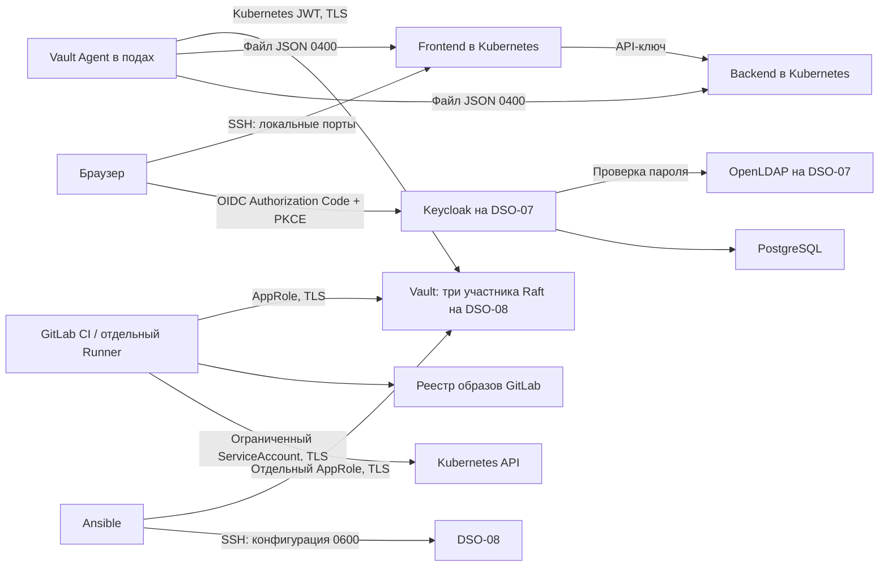

| Размещение | Ресурсы | Компоненты |
|---|---|---|
| DSO-07, Debian | 2 vCPU, 4 GiB RAM | Keycloak, PostgreSQL, OpenLDAP, TLS-прокси |
| DSO-08, Ubuntu 22.04 | 4 vCPU, 8 GiB RAM | Kubernetes, Vault, Injector, frontend, backend |
| Компьютер оператора | Docker Desktop | Выделенный GitLab Runner; SSH-соединения с ВМ |

ВМ для Keycloak и Vault разделены. У DSO-07 меньше ресурсов, чем рекомендованные в задании 4 CPU / 8 GB; для двух учебных пользователей достаточно. Ограничения памяти контейнеров заданы в Compose. Приложение и хранилище секретов работают на ВМ, Docker Desktop используется для Runner и сборки.

| Компонент | Версия / образ |
|---|---|
| Keycloak | `quay.io/keycloak/keycloak:26.8.1` |
| PostgreSQL | `postgres:17.11-bookworm` |
| OpenLDAP | `osixia/openldap:1.5.0` |
| TLS-прокси | `nginx:1.30-alpine`, digest закреплён в Compose |
| Vault и Vault Agent | `hashicorp/vault:1.20.4` |
| Helm-чарт Vault | `0.31.0`, commit `da81d965d3968a19a3da9286f0993da5cd0866de` |
| Kubernetes / containerd | `1.31.2` / `1.7.23` |
| Сетевая политика | Calico |
| Приложение | Python 3.12; зависимости закреплены в `app/requirements.txt` |
| GitLab Runner | `gitlab/gitlab-runner:alpine-v19.3.1` |
| Сборка | `moby/buildkit:v0.34.2-rootless` |
| Проверка секретов | Gitleaks `8.30.1` |

Между выданными ВМ нет прямого сетевого доступа. Для служебных HTTPS-запросов к Keycloak используется SSH-проброс через компьютер оператора. Адрес `keycloak.infrasec.internal` в поде указывает на частный адрес DSO-08; обратный SSH-проброс доставляет соединение к TLS-прокси DSO-07. Шифрование SSH и проверка сертификата Keycloak сохраняются. Публичные порты в интернете не открываются.

## Настройки компонентов

### Keycloak и LDAP

- Realm приложения — `infrasec`; клиент — `infrasec-web`, конфиденциальный OpenID Connect.
- Включён Standard Flow с PKCE `S256`. Implicit Flow, Direct Access Grants и учётная запись сервиса клиента выключены.
- Единственный адрес возврата — `http://127.0.0.1:18080/auth/callback`.
- Публичный адрес Keycloak — `http://127.0.0.1:18081`; служебный — `https://keycloak.infrasec.internal:18443`.
- LDAP: `ldap://openldap:389`, база поиска `ou=users,dc=infrasec,dc=test`. Подключение выполняет `cn=keycloak-reader,ou=services,dc=infrasec,dc=test`.
- Федерация работает в режиме `READ_ONLY`. Учётные записи `alice` и `bob` импортированы из LDAP; их пароли проверяет LDAP. Полная синхронизация — раз в сутки, изменений — раз в 15 минут.
- В realm приложения нет отдельных локальных пользователей. Постоянный администратор `infrasec-admin` находится в `master`; временный администратор первичной настройки отключён.

ACL LDAP разрешает служебной записи поиск пользователей, запрещает чтение `userPassword` и изменение записей. Анонимный поиск закрыт. Пароли администратора, подключения к LDAP, базы данных и пользователей создаются случайно и сохраняются вне Git.

Конфигурация: [Compose](identity/compose.yaml), [TLS-прокси](identity/compose.tls.yaml), [настройка realm и федерации](scripts/identity_setup.py), [ACL LDAP](identity/ldap-acl.ldif). Подробности — [identity/README.md](identity/README.md).

### Vault

Vault запущен в серверном режиме HA с Raft, без `dev` и `standalone`. Три экземпляра имеют отдельные постоянные тома данных и аудита. Инициализация создаёт три доли ключа; для разблокировки нужны две. Есть один лидер и два резервных участника. TLS проверяется собственным CA, созданным cert-manager.

| Потребитель | Метод / роль | Разрешённое чтение KV v2 |
|---|---|---|
| Frontend | Kubernetes, `infrasec-frontend` | `secret/data/infrasec/app/frontend` |
| Backend | Kubernetes, `infrasec-backend` | `secret/data/infrasec/app/backend` |
| GitLab CI | AppRole, `infrasec-ci` | `secret/data/infrasec/ci/deploy` |
| Ansible | AppRole, `infrasec-ansible` | `secret/data/infrasec/infrastructure/credentials` |
| Оператор | Административный доступ | `secret/data/infrasec/infrastructure/identity` с исходными реквизитами настройки |

В политиках используются точные пути. Приложение, CI и Ansible не могут читать секреты друг друга или менять значения. Политика `default` к их токенам не добавляется. Пример:

```hcl
path "secret/data/infrasec/app/frontend" {
  capabilities = ["read"]
}
```

Kubernetes-роли ограничены парой `frontend-sa@infrasec` или `backend-sa@infrasec`, аудитория JWT — `vault`. Токен Vault действует сначала 5 минут, не более 15 минут. Для AppRole предел токена — 10 минут; SecretID действует два часа и допускает 20 входов. Проверочные токены отзываются после использования.

Конфигурация: [HA и хранилище](vault/ha-values.yaml), [TLS](vault/tls.yaml), [политики](vault/policies), [инициализация](scripts/initialize_vault.py), [KV и роли](scripts/vault_setup.py). Дополнительные команды — [vault/README.md](vault/README.md).

### Kubernetes и приложение

Пространство имён `infrasec` помечено для нового Injector. Webhook добавляет init-контейнер и работающий рядом с приложением Vault Agent. Агент входит по короткоживущему JWT своего ServiceAccount и записывает `/vault/secrets/config.json` с правами `0400`, владельцем UID 1000. Секреты поступают как файлы, а не как переменные окружения. Приложение не получает JWT или токен Vault.

Оба приложения и агенты работают от UID 1000: `runAsNonRoot`, `allowPrivilegeEscalation: false`, корневая файловая система только для чтения, удалены все capabilities, включён `RuntimeDefault` seccomp. Namespace защищён PSA `baseline`.

Сетевые политики закрывают входящий и исходящий трафик по умолчанию. Отдельно разрешены DNS, frontend → backend, обращения агентов к Vault и служебное соединение frontend с Keycloak. Службы приложения имеют тип `ClusterIP`.

Веб-сервис проверяет подпись ID token, `issuer`, `audience`, `state` и `nonce`; использует PKCE. В cookie нет OIDC-токенов, только сведения сеанса. Cookie подписана, имеет `HttpOnly`, `SameSite=Lax` и срок 15 минут. Backend принимает запросы только с API-ключом из Vault; значение сравнивается через `hmac.compare_digest`.

Файлы: [манифесты приложения и аннотации Injector](manifests/10-apps.yaml), [NetworkPolicy](manifests/20-network-policies.yaml), [код приложения](app), [описание приложения](app/README.md).

### GitLab CI и Ansible

[`.gitlab-ci.yml`](.gitlab-ci.yml) выполняет шесть задач: `unit_tests`, `gitleaks`, `vault_secrets`, `build_image`, `deploy_application`, `verify_pipeline`. Образ публикуется с меткой полного SHA коммита; для развёртывания используется его неизменяемый digest `sha256`. Задача развёртывания проверяет маркер из Vault, записывает его SHA256 в аннотацию пода и дожидается готовности обеих новых реплик.

Секреты доступны только защищённым веткам и задачам окружения `infrasec`. RoleID, SecretID и токен Kubernetes имеют `Masked`, `Hidden`, `Protected`. CA передаются как файловые переменные. Root token не передаётся в GitLab. Проверка с `CI_DEBUG_TRACE=true` запрещена. В журнал попадают имя ключа, длина и SHA256; значение не выводится. Список переменных и порядок работы — [ci/README.md](ci/README.md).

Runner закреплён за этим проектом, принимает только защищённые задания с меткой `infrasec`. Контейнеры заданий не имеют Docker socket и не запускаются в `privileged`-режиме. Для rootless BuildKit ослаблены seccomp/AppArmor именно контейнеров заданий; поэтому Runner не предназначен для чужих проектов или недоверенных веток.

[Плейбук Ansible](ansible/deploy.yml) получает отдельный AppRole из внешнего закрытого файла, запрашивает секрет по HTTPS и создаёт на DSO-08 `deploy.conf` с правами `0600`. Задачи с секретами используют `no_log: true`, показ различий отключён. Временный токен отзывается и при ошибке. Второй запуск не изменяет конфигурацию. Команды — [ansible/README.md](ansible/README.md).

## Развёртывание

### 1. Подготовить доступ и инструменты

Нужны две ВМ, доступ по SSH с проверкой ключа сервера и кластер Kubernetes. На DSO-07 установлены Docker с Compose и Python 3. На DSO-08 нужны `kubectl`, Helm, Python 3, Calico с действующими NetworkPolicy, cert-manager и StorageClass `local-path`. В учебном DSO-08 эти компоненты уже установлены. Установка самого Kubernetes не входит в скрипты проекта.

На компьютере оператора нужны Git, Python 3.11+, `glab`, Docker Desktop и настроенный учебный SSH-доступ через Pomerium CLI. Файлы SSH-конфигурации должны содержать проверенные ключи серверов и псевдонимы `dso07`, `dso08`. Закрытые ключи и kubeconfig в проект не копируются.

Склонируйте репозиторий на компьютер оператора и обе ВМ. Далее команды выполняются из его корня; блоки отдельно указывают, на какой машине их запускать. Выберите внешнюю закрытую папку на компьютере оператора:

```bash
umask 077
export INFRASEC_PRIVATE="$HOME/.local/share/infrasec-private"
mkdir -p "$INFRASEC_PRIVATE"
chmod 700 "$INFRASEC_PRIVATE"
python3 -m venv "$INFRASEC_PRIVATE/tools"
"$INFRASEC_PRIVATE/tools/bin/python" -m pip install -r ci/requirements.txt
export INFRASEC_IDENTITY_SSH_CONFIG=/absolute/path/to/dso07/ssh-config
export INFRASEC_K8S_SSH_CONFIG=/absolute/path/to/dso08/ssh-config
```

IP-адреса учебных ВМ в Compose, сертификате, `hostAliases`, NetworkPolicy и SSH-пробросе должны совпадать. В проверенном стенде DSO-07 — `10.91.0.36`, DSO-08 — `10.91.0.17`. При других адресах замените их во всех перечисленных конфигурациях до применения.

### 2. Развернуть Keycloak и LDAP на DSO-07

```bash
umask 077
python3 scripts/identity_setup.py \
  --private-dir /home/debian/devsecops/infrasec-private --prepare
docker compose \
  --env-file /home/debian/devsecops/infrasec-private/identity.env \
  -f identity/compose.yaml up -d
bash identity/apply-ldap-acl.sh \
  /home/debian/devsecops/infrasec-private/identity.env
```

Дождитесь готовности Keycloak, затем создайте realm, клиента, администратора и федерацию:

```bash
python3 scripts/identity_setup.py \
  --private-dir /home/debian/devsecops/infrasec-private \
  --keycloak-url http://127.0.0.1:8085 \
  --evidence-dir artifacts/identity
python3 identity/verify_ldap.py \
  --env-file /home/debian/devsecops/infrasec-private/identity.env
```

Скопируйте `identity.json` с ВМ в `$INFRASEC_PRIVATE/identity/identity.json` на компьютере оператора по SSH. Права каталога — `0700`, файла — `0600`. Файл нужен для первоначального заполнения Vault и проверки учебных пользователей; не добавляйте его в Git.

### 3. Развернуть и разблокировать Vault на DSO-08

```bash
bash scripts/install_vault.sh
python3 scripts/initialize_vault.py \
  --private-dir /home/ubuntu/devsecops/infrasec-ha-private \
  --evidence-file artifacts/vault/ha-status.json
```

Скрипт устанавливает проверенный официальный чарт, создаёт отдельный CA и три участника Raft, инициализирует новое хранилище и выполняет unseal. Ключи сохраняются только в `/home/ubuntu/devsecops/infrasec-ha-private/vault-init.json`. Скопируйте этот файл и открытый `ca.crt` в `$INFRASEC_PRIVATE/ha-vault/` на компьютере оператора; храните резервные доли ключа отдельно друг от друга. Сам файл не показывайте в отчёте или скриншоте.

Повторный запуск `initialize_vault.py` с той же закрытой папкой разблокирует существующий кластер после перезапуска. Он проверяет CA и идентификатор хранилища и не выполняет повторную инициализацию поверх данных.

### 4. Включить TLS Keycloak и SSH-соединения

На DSO-08 выпустите сертификат Keycloak от созданного CA:

```bash
kubectl apply -f identity/tls-certificate.yaml
kubectl -n infrasec-vault wait --for=condition=Ready \
  certificate/infrasec-keycloak --timeout=120s
umask 077
kubectl -n infrasec-vault get secret infrasec-keycloak-tls -o json \
  > /home/ubuntu/devsecops/infrasec-ha-private/keycloak-tls.json
```

На DSO-08 извлеките сертификаты и ключ без вывода значений:

```bash
python3 - <<'PY'
import base64, json, os
from pathlib import Path
os.umask(0o077)
private = Path('/home/ubuntu/devsecops/infrasec-ha-private')
data = json.loads((private / 'keycloak-tls.json').read_text())['data']
target = private / 'keycloak-tls'
target.mkdir(mode=0o700, exist_ok=True)
for name in ('tls.crt', 'tls.key', 'ca.crt'):
    (target / name).write_bytes(base64.b64decode(data[name]))
    (target / name).chmod(0o600)
PY
```

Скопируйте каталог `keycloak-tls` по проверенным SSH-соединениям через компьютер оператора в `/home/debian/devsecops/infrasec-private/tls/` на DSO-07. Каталог должен принадлежать UID 1000, иметь права `0700`, файлы — `0600`. Затем на DSO-07:

```bash
docker compose \
  --env-file /home/debian/devsecops/infrasec-private/identity.env \
  -f identity/compose.yaml -f identity/compose.tls.yaml up -d
```

На DSO-08 разрешите ограниченный обратный SSH-проброс:

```bash
bash scripts/configure_bridge.sh
```

На компьютере оператора запустите в отдельном терминале:

```bash
bash scripts/start_tunnels.sh
```

Скрипт открывает только локальные порты: приложение `18080`, Keycloak `18081`, служебный backend `18082`, Vault `18202`, Kubernetes API `16443`; дополнительно работает закрытый SSH-проброс TLS Keycloak. Терминал с соединениями должен оставаться открытым. Циклы повторяют проброс после смены подов.

### 5. Настроить секреты и политики

На компьютере оператора:

```bash
export VAULT_ADDR=https://127.0.0.1:18202
export VAULT_CACERT="$INFRASEC_PRIVATE/ha-vault/ca.crt"
export INFRASEC_VAULT_ADMIN_FILE="$INFRASEC_PRIVATE/ha-vault/vault-init.json"
export INFRASEC_OIDC_CLIENT_FILE="$INFRASEC_PRIVATE/identity/identity.json"
export INFRASEC_IDENTITY_FILE="$INFRASEC_PRIVATE/identity/identity.json"
python3 scripts/vault_setup.py \
  --private-dir "$INFRASEC_PRIVATE/ha-vault" \
  --evidence-file artifacts/checks/vault-setup.json
python3 scripts/vault_setup.py \
  --private-dir "$INFRASEC_PRIVATE/ha-vault" --verify \
  --evidence-file artifacts/checks/vault-approle-check.json
```

Скрипт включает KV v2, AppRole, Kubernetes auth и файловый аудит, создаёт четыре политики и соответствующие роли. Случайные значения приложения согласованы между frontend и backend; повторный запуск сохраняет их. Секрет OIDC берётся из реально созданного клиента Keycloak. Настройка Kubernetes auth использует локальный ServiceAccount Vault и обновляемый JWT, постоянный reviewer token не сохраняется.

### 6. Подготовить GitLab, Kubernetes и Runner

Войдите в учебный GitLab через `glab auth login --hostname devsecops.gitlab.yandexcloud.net`; токен вводится в терминале, не в коде. По умолчанию скрипт проверяет учебный проект `s2417991/infrasec` (ID 1165). Для другого проекта передайте `--project <ID> --project-path <namespace/project>`; адрес учебного GitLab также проверяется до изменений. Новый DeployToken имеет только `read_registry` и срок семь дней; другой срок задаётся через `--registry-expires YYYY-MM-DD`.

На компьютере оператора создайте отдельный Runner и токен чтения реестра:

```bash
python3 scripts/configure_gitlab.py \
  --private-dir "$INFRASEC_PRIVATE/gitlab" \
  --create-runner --create-registry-token
```

Передайте `registry.json` и открытый CA Vault в закрытую папку DSO-08. На DSO-08 установите зависимости в отдельное виртуальное окружение и выполните подготовку Kubernetes:

```bash
python3 -m venv /home/ubuntu/devsecops/infrasec-tools
/home/ubuntu/devsecops/infrasec-tools/bin/python -m pip install -r ci/requirements.txt
/home/ubuntu/devsecops/infrasec-tools/bin/python scripts/bootstrap_kubernetes.py \
  --ca-file /home/ubuntu/devsecops/infrasec-ha-private/ca.crt \
  --registry-file /home/ubuntu/devsecops/infrasec-ha-private/registry.json \
  --private-dir /home/ubuntu/devsecops/infrasec-ha-private \
  --kube-api-url https://kubernetes:16443 \
  --token-duration 10800
```

Скрипт подготавливает namespace, ServiceAccount, службы, сетевые политики, CA приложения и агентов, Secret для чтения реестра, ограниченные RBAC-права CI. Закрытый `kube-ci.json` с трёхчасовым токеном создаётся вне Git. Скопируйте его на компьютер оператора в `$INFRASEC_PRIVATE/kube-ci.json`.

Настройте защищённые переменные:

```bash
python3 scripts/configure_gitlab.py \
  --private-dir "$INFRASEC_PRIVATE/gitlab" \
  --approle-file "$INFRASEC_PRIVATE/ha-vault/ci-approle.json" \
  --vault-address https://infrasec-vault-active.infrasec-vault.svc:18202 \
  --vault-ca-file "$INFRASEC_PRIVATE/ha-vault/ca.crt" \
  --kube-file "$INFRASEC_PRIVATE/kube-ci.json"
python3 scripts/runner_setup.py \
  --runner-file "$INFRASEC_PRIVATE/gitlab/runner.json" \
  --private-dir "$INFRASEC_PRIVATE/runner"
docker compose --env-file "$INFRASEC_PRIVATE/runner/runner.env" \
  -f ci/runner-compose.yaml up -d
```

Для Docker Desktop адрес шлюза, указанный в Runner, — `192.168.65.254`. Если он отличается, передайте `--docker-host-address` при подготовке нового файла конфигурации. Runner должен достигать локальных SSH-пробросов Vault и Kubernetes API; проверка CA обязательна.

В GitLab защитите `main` и рабочую ветку `infrastructure`. Конвейер работает только для этих защищённых веток; не включайте force push. Загрузите код в рабочую ветку и запустите конвейер. Первая сборка опубликует образ `$CI_REGISTRY_IMAGE/app:$CI_COMMIT_SHA` и сохранит его digest в отчёт сборки. Затем CI создаст два Deployment с адресом образа вида `$CI_REGISTRY_IMAGE/app@sha256:...` и проверит готовность. Манифест содержит параметр `INFRASEC_APP_IMAGE`; его заменяет CI в памяти. Для ручного применения используйте `bootstrap_kubernetes.py --apply-deployments --image <полный-адрес-готового-образа-с-digest>`.

SecretID Vault и токен Kubernetes ограничены по времени. Перед поздним повторным запуском выдайте новые реквизиты: `vault_setup.py --refresh-approle`, повторный выпуск CI-токена и обновление защищённых переменных. Инициализация Vault при этом не нужна.

### 7. Запустить Ansible и проверки

На компьютере оператора установите `ansible/requirements.txt` в отдельное виртуальное окружение. Создайте закрытый inventory по [примеру](ansible/inventory.example.yml), задав SSH-подключение к DSO-08 с проверкой ключа сервера. Затем:

```bash
export INFRASEC_ANSIBLE_APPROLE_FILE="$INFRASEC_PRIVATE/ha-vault/ansible-approle.json"
ansible-playbook -i /absolute/path/outside-repository/inventory.yml ansible/deploy.yml
ansible-playbook -i /absolute/path/outside-repository/inventory.yml ansible/deploy.yml
```

Выполните итоговые проверки:

```bash
python3 -m venv app/.venv
app/.venv/bin/python -m pip install -r app/requirements-dev.txt
app/.venv/bin/python -m pytest -p no:cacheprovider -q tests
app/.venv/bin/python scripts/verify_integration.py \
  --identity-file "$INFRASEC_PRIVATE/identity/identity.json" \
  --app-values-file "$INFRASEC_PRIVATE/ha-vault/app-values.json" \
  --vault-ca-file "$INFRASEC_PRIVATE/ha-vault/ca.crt" \
  --vault-url https://127.0.0.1:18202 \
  --ssh-config "$INFRASEC_K8S_SSH_CONFIG"
```

На DSO-08 выполните `bash scripts/test_netpol.sh`. В браузере откройте `http://127.0.0.1:18080`, войдите под учебным LDAP-пользователем и проверьте `/profile`. Пароль возьмите из закрытого `identity.json`, не помещайте его в отчёт. Для просмотра Vault без секретных значений предусмотрен `scripts/inspect_vault.py`.

После всех настроек и проверок завершите первичную настройку Vault по [инструкции](vault/README.md#завершение-первичной-настройки). На проверенном стенде начальный root token отозван; повторный вход с ним возвращает 403. Доли ключа сохранены вне Git. Временный независимый токен позволяет только просматривать настройки и не может читать секреты: [результат проверки](artifacts/vault/bootstrap-finalized.json).

Для сдачи подготовлен [MR №1](https://devsecops.gitlab.yandexcloud.net/s2417991/infrasec/-/merge_requests/1) из `infrastructure` в `main`. Перед отправкой его следует объединить после успешной проверки итогового коммита и проверить доступ к файлам без авторизации.

## Проверки и доказательства

[Результаты финального ревью](artifacts/review.md).


| Проверка | Подтверждение |
|---|---|
| Realm, OIDC-клиент, LDAP и пользователи | Скриншоты ниже; [LDAP ACL](artifacts/identity/ldap-acl-check.json) |
| Vault инициализирован и разблокирован, три участника Raft, TLS | [ha-status.json](artifacts/vault/ha-status.json), [вывод команд](artifacts/vault/ha-cli-summary.txt) |
| KV v2, методы входа и политики | [configuration.json](artifacts/vault/configuration.json) |
| Раздельные AppRole, запрет чужих путей и записи | [17 проверок, ошибок нет](artifacts/checks/vault-approle-check.json) |
| Защищённые переменные CI | [Метаданные без значений](artifacts/checks/gitlab-protected-variables.json) |
| Реальная сборка и развёртывание через GitLab | [Конвейер №15908](https://devsecops.gitlab.yandexcloud.net/s2417991/infrasec/-/pipelines/15908), [метаданные и журналы шести задач](artifacts/ci/pipeline-15908), [сверка одного коммита](artifacts/ci/pipeline-15908/verification.json) |
| Приложение, OIDC-вход, Vault, запрет доступа с другим ServiceAccount | [Итоговый JSON](artifacts/integration/verification.json), [читаемый отчёт](artifacts/integration/verification.md) |
| Сетевая изоляция с положительным контролем | [network-policy.txt](artifacts/integration/network-policy.txt) |
| Приложение и Agent доверяют новому CA | [ha-cutover.json](artifacts/kubernetes/ha-cutover.json) |
| Ansible: первый и повторный запуск | [Результат и отсутствие секретов в логах](artifacts/ansible/verification.json), [первый запуск](artifacts/ansible/run-first.txt), [повторный запуск](artifacts/ansible/run-second.txt) |
| Проверка секретов в коде | Gitleaks в успешном конвейере; [первичная локальная проверка](artifacts/checks/gitleaks-initial.json) |

Проверка NetworkPolicy выполняет три запроса: frontend достигает backend (ответ `401` без API-ключа), под из постороннего namespace получает тайм-аут, frontend повторно достигает backend. Положительный контроль исключает ложный результат из-за неработающего сервиса. Полная проверка отдельно подтверждает ответ `200` с правильным ключом.

Ansible выполнил оба запуска без ошибок: первый — `ok=13, changed=1`, повторный — `ok=13, changed=0`. Плейбук проверил права `0600` и совпадение SHA256 файла с секретом Vault. Значений секрета в сохранённых журналах нет.

Конвейер №15908 выполнил 20 тестов без пропусков; все десять итоговых условий в `verification.json` выполнены. Журналы и метаданные перед сохранением проверены на совпадения с известными значениями секретов. Полные ответы GitLab с переменными не сохраняются.

Полная проверка работающей системы завершилась с результатом **21 успешно, 0 ошибок**. Она проверяет вход обоих LDAP-пользователей, запрет доступа без входа и после выхода, API-ключ backend, файлы Agent, ограничения ServiceAccount, аудиторию JWT, чужие пути Vault и отзыв тестовых токенов.

### Скриншоты

Снимки сделаны с работающих интерфейсов. Пароли, токены и значения секретов на них не показаны. Vault UI открыт через временный прокси на loopback компьютера оператора: прокси проверяет CA Vault, далее соединение проходит через SSH к ВМ. Для журналов Kubernetes и Ansible показаны сохранённые реальные результаты проверок.

Realm приложения:

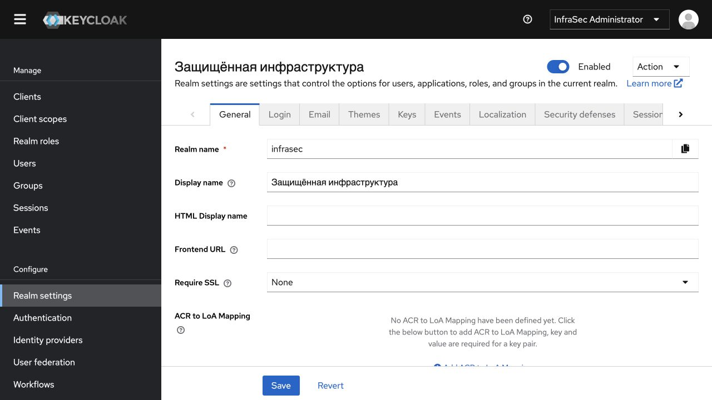

Клиент OpenID Connect:

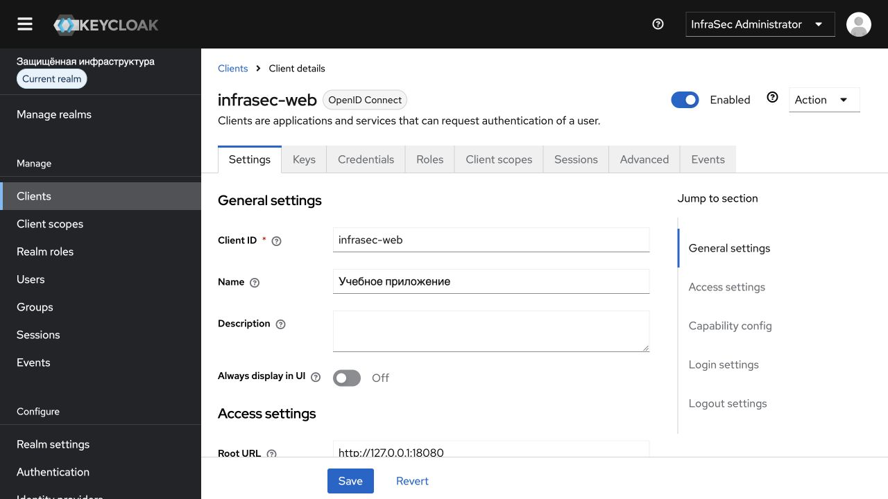

Подключение к LDAP:

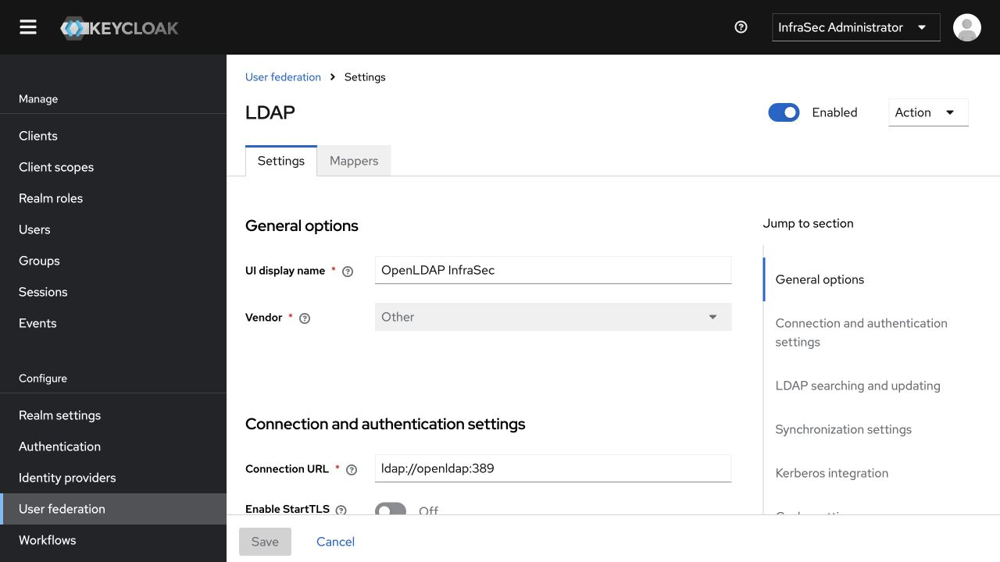

Проверка соединения, учётная запись чтения и режим READ_ONLY:

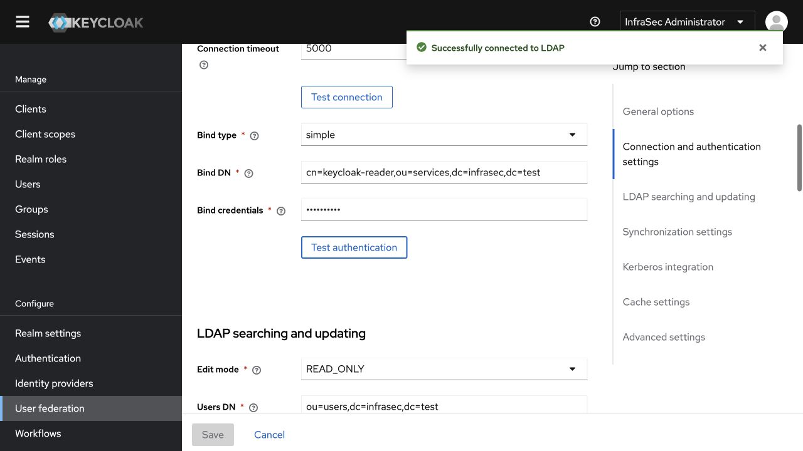

Импортированные пользователи:

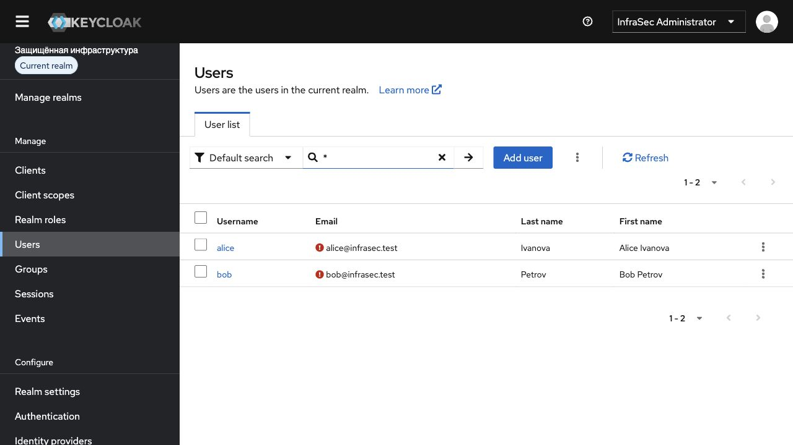

Успешный вход под LDAP-пользователем и ответ внутреннего API:

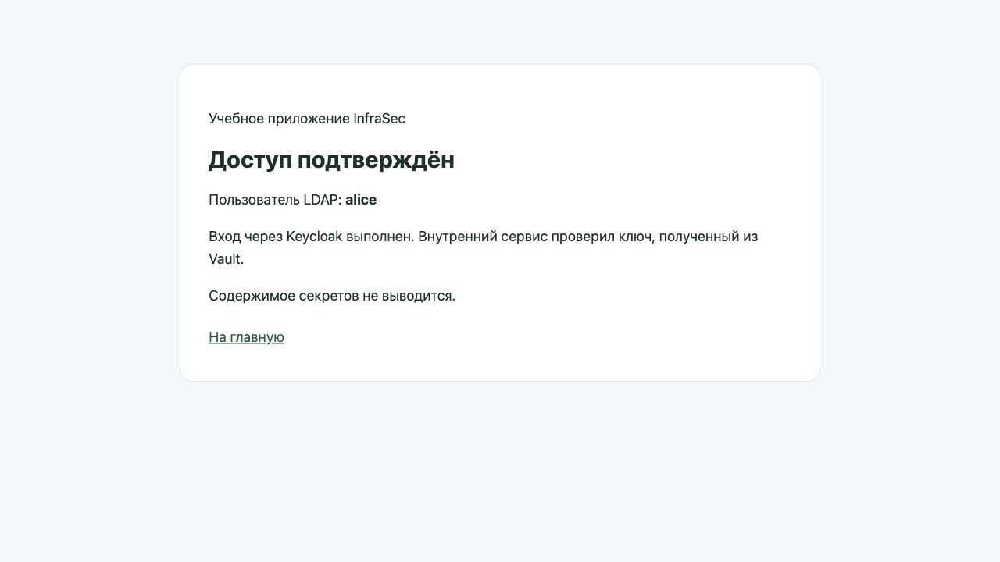

Инициализированное и разблокированное хранилище Vault, участники Raft:

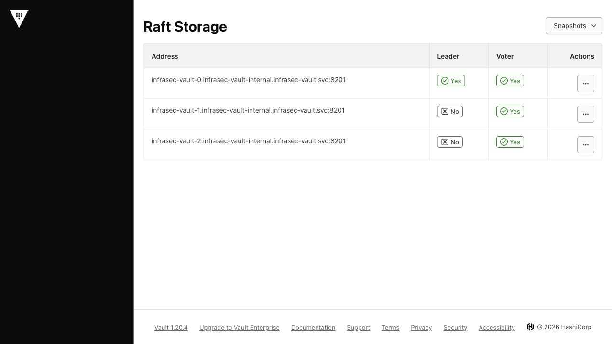

Секретный движок KV v2:

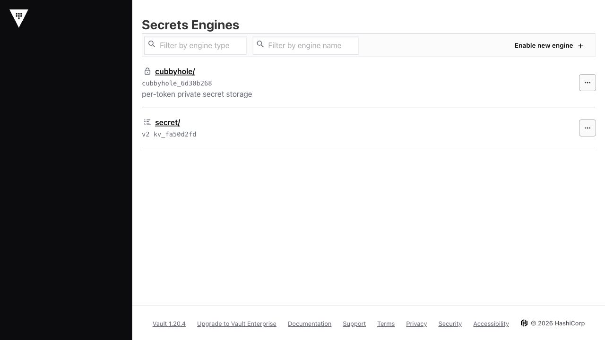

Раздельные политики доступа:

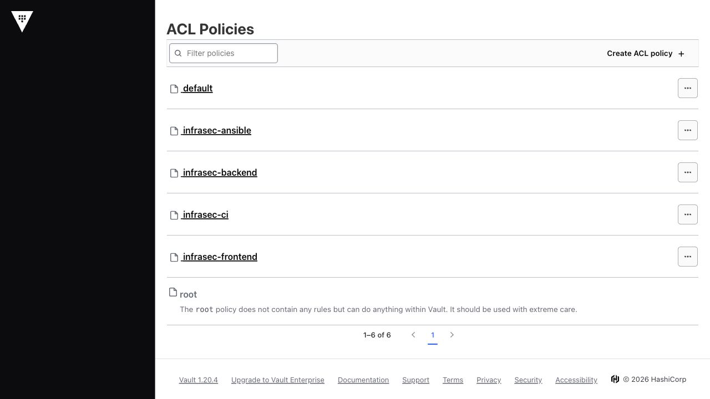

Политика frontend разрешает чтение только своего пути и работу с собственным токеном:

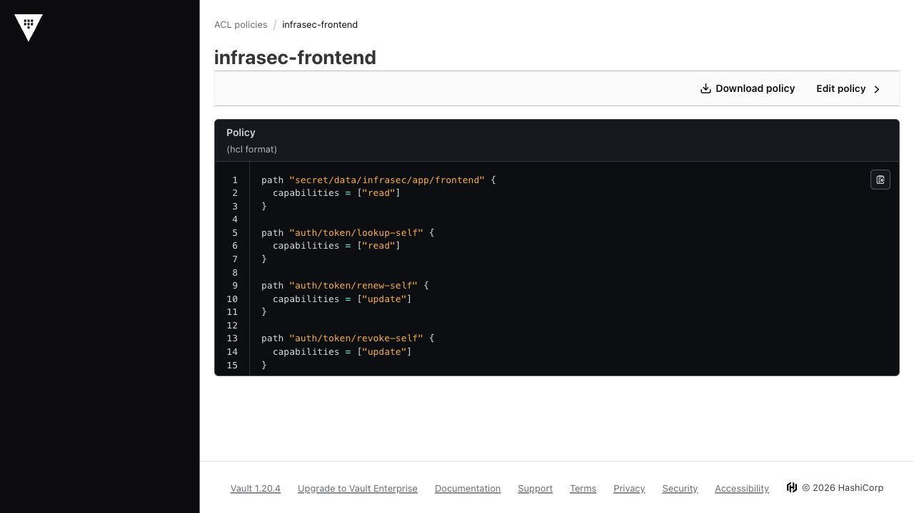

Успешный конвейер GitLab:

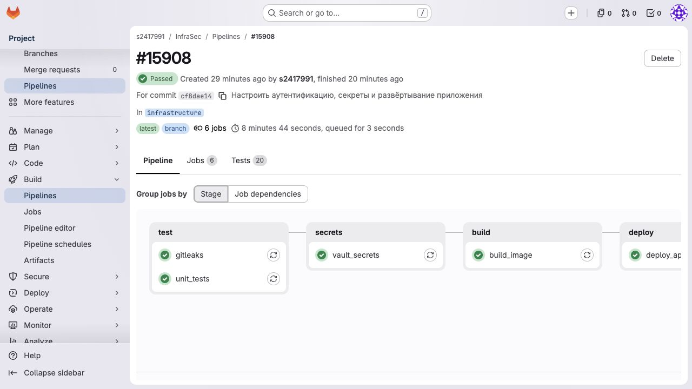

Задача получения секрета: показаны имя ключа, длина и контрольная сумма, значение отсутствует:

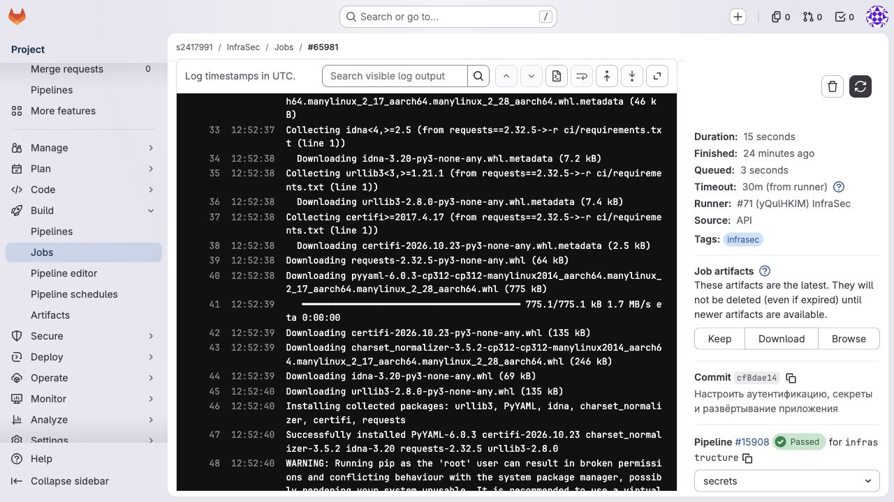

Сохранённый вывод проверки Kubernetes: приложение и Vault Agent готовы, файл секрета совпадает с Vault, права файла проверены. Значения заменены результатом сравнения:

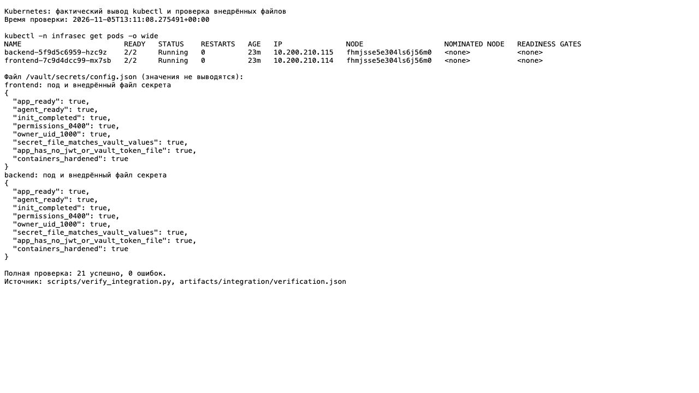

Сохранённый журнал успешных запусков Ansible без значений секретов:

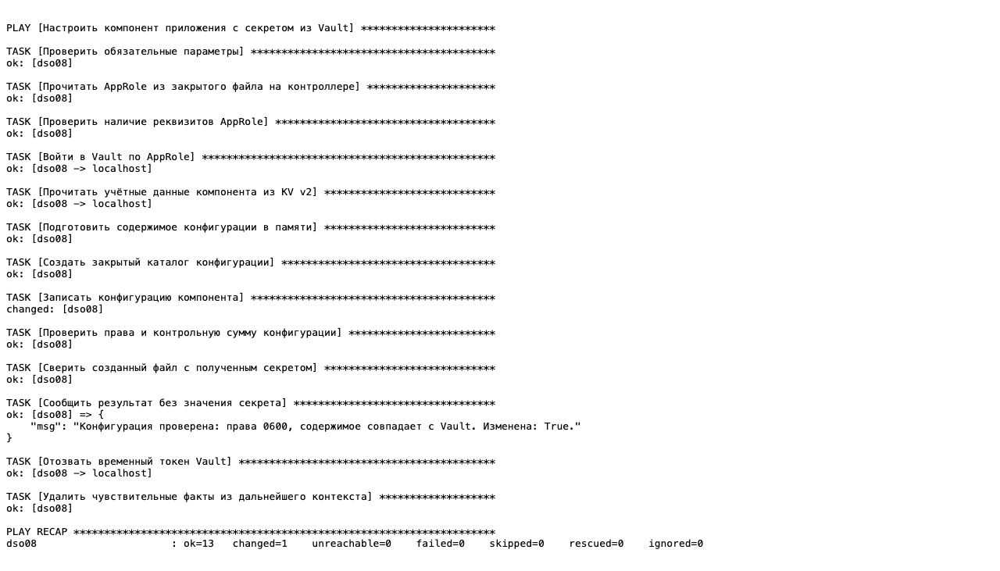

Сохранённый вывод проверки NetworkPolicy с положительным контролем:

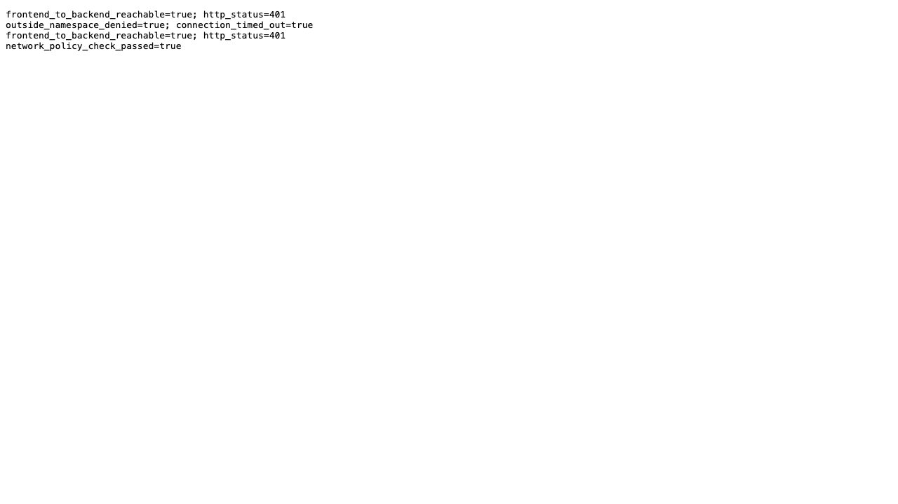

Инициализация и разблокировка Vault (`initialized=true`, `sealed=false`, две доли из трёх):

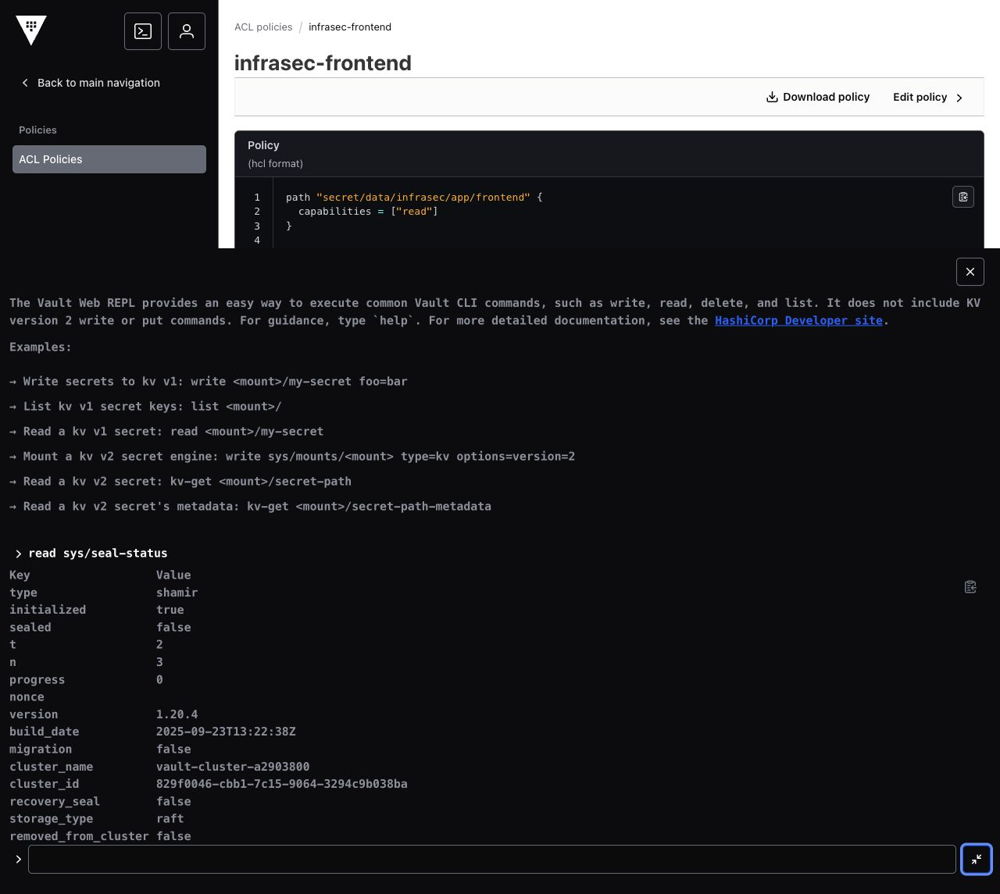

## Меры безопасности

| Практика | Реализация |
|---|---|
| Централизованные учётные записи | Keycloak и LDAP; пароли пользователей не копируются в приложение |
| Минимальные права | Четыре точные ACL Vault, отдельные Kubernetes SA, Role CI только в `infrasec`, LDAP-reader без записи |
| Секреты вне Git | Случайные значения в Vault; исходные реквизиты и ключи только во внешних закрытых папках; Gitleaks проверяет историю и текущий коммит |
| Ограниченный срок доступа | JWT с аудиторией `vault`, короткоживущие Vault-токены и SecretID, отзыв проверочных токенов |
| Проверка транспорта | TLS Vault и служебных запросов Keycloak с проверкой CA; пользовательский HTTP проходит через SSH и loopback |
| Защита административных интерфейсов | Нет публичного ingress/NodePort; Keycloak на loopback, Vault — ClusterIP; доступ оператора через SSH и аутентификацию |
| Защита приложения | OIDC Code Flow с PKCE, проверка токенов, подписанные короткие сеансы, экранирование имени пользователя, ключ backend из Vault |
| Защита подов | Непривилегированные контейнеры, read-only rootfs, seccomp, удалённые capabilities, PSA и NetworkPolicy |
| Безопасная автоматизация | Защищённые переменные GitLab; `no_log` в Ansible; запрет отладочной трассировки CI; секреты не передаются в сборку образа |
| Учёт операций | Файловый аудит Vault на постоянных томах; безопасные результаты проверок в `artifacts/` |

Эти меры соответствуют направлениям [CIS Controls 5 и 6](https://www.cisecurity.org/controls/v8) по управлению учётными записями и доступом, а также рекомендациям [OWASP Secrets Management](https://cheatsheetseries.owasp.org/cheatsheets/Secrets_Management_Cheat_Sheet.html). Это сопоставление отдельных мер, а не заявление о полном соответствии стандартам или сертификации.

Terraform в работе не используется. Файлов состояния Terraform в репозитории нет; соответствующие типы файлов добавлены в `.gitignore`. Ansible Vault не требуется: секреты получаются непосредственно из HashiCorp Vault, а исходные реквизиты находятся вне Git.

## Ограничения стенда

- Три участника Raft размещены на одной физической учебной ВМ. Это демонстрирует HA-режим Vault, но не защищает от отказа самой ВМ. Для рабочей инфраструктуры нужны разные узлы и независимое хранилище резервных копий.
- LDAP и PostgreSQL доступны только внутри сети Compose; внутри этой сети используется незашифрованный протокол. Для рабочей среды нужны LDAPS/StartTLS и TLS базы данных. Внешний трафик Keycloak и Vault защищён TLS/SSH.
- Локальные HTTP-адреса в браузере предназначены для SSH-доступа. Для общего доступа к приложению нужны публичный HTTPS-адрес, соответствующие redirect URI и `Secure` cookie.
- SSH-пробросы и Runner зависят от компьютера оператора и времени работы учебных ВМ. При остановке ВМ сначала восстановите SSH, unseal Vault и готовность подов; затем повторите проверки.
- Образ OpenLDAP `1.5.0` старый. Gitleaks проверяет утечки секретов, а не уязвимости пакетов. Отсутствие CVE в образах не заявляется; перед рабочим использованием нужны актуальные образы и отдельное сканирование.
- При работе отзываются временные токены проверок; исходные ключи разблокировки и административные реквизиты требуют отдельного защищённого хранения. Не публикуйте содержимое закрытых папок, `docker inspect`, `docker compose config` или ответы Vault с секретами.

## Состав репозитория

| Каталог / файл | Назначение |
|---|---|
| `app/`, `tests/` | Два сервиса и проверки аутентификации, сеансов и конфигурации |
| `identity/` | Compose Keycloak, PostgreSQL и LDAP, TLS-прокси, ACL |
| `vault/` | HA-чарт, сертификаты, политики |
| `manifests/` | Namespace, SA, Deployment, службы, NetworkPolicy и RBAC CI |
| `ansible/` | Получение секрета и применение конфигурации |
| `ci/`, `.gitlab-ci.yml` | Тесты, Gitleaks, Vault, сборка, развёртывание и итоговая сверка |
| `scripts/` | Настройка компонентов, SSH-пробросы и проверки интеграций |
| `artifacts/` | Проверенные журналы, JSON-отчёты и реальные скриншоты без значений секретов |

Официальная документация: [Keycloak](https://www.keycloak.org/guides), [LDAP federation](https://www.keycloak.org/docs/latest/server_admin/index.html#_ldap), [Vault Raft](https://developer.hashicorp.com/vault/docs/configuration/storage/raft), [Kubernetes auth](https://developer.hashicorp.com/vault/docs/auth/kubernetes), [Vault Agent Injector](https://developer.hashicorp.com/vault/docs/platform/k8s/injector), [AppRole](https://developer.hashicorp.com/vault/docs/auth/approle), [BuildKit в GitLab](https://docs.gitlab.com/ci/docker/using_buildkit/).
